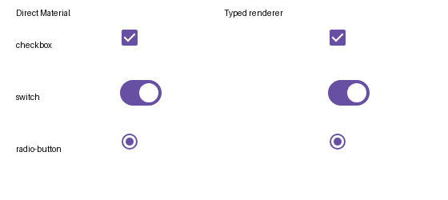

# Parallel Kotlin-authored M3 catalog

The production catalog still reads the committed `ui-builder.policy.json` and builds the existing
`:catalog-ui-builder-renderer`. This experiment writes separate outputs and publishes nothing.
It is the consumer that proves the typed API before that API becomes the default.

There are two linked pieces:

- `:catalog-typed-policy` declares the **entire existing policy** in Kotlin. Its 38 record policies,
  two builtins, menu order, templates, source-export adapter and upgrade rules preserve the current
  contract. Properties and slots use the owning protocol builders before serialization; fields the
  catalog protocol deliberately carries as JSON use Kotlin JSON builders. It never reads the old
  JSON to generate its output. The equivalence test reads the old file only as its independent
  baseline, normalizes protocol defaults and documentation comments, and compares all policy data.
- `:catalog-typed-adapters` starts the property-reference/renderer migration with checkbox, switch
  and radio button. The public wrappers call the real Material APIs. JVM discovery reads their
  compiled signatures; `TypedM3Catalog` uses those records with actual property and callback
  references; the renderer registers those exact definitions. The same declarations generate the
  portable `components.json` / `ui-builder.json` pair and the Wasm adapter table. Browser records are
  generated from JVM discovery, never maintained as a signature fixture.

The pilot uses a **separate catalog identity**, `m3-catalog-typed-pilot`, while retaining the three
`m3/*` component ids. It does not claim compatibility with saved `m3-catalog` designs. In particular,
the typed API's Boolean capability differs from the current `boolean/string/object` declarations,
canvas ids become the adapter ids, and source calls target the repository's wrappers. These
differences need proving or resolving before a cutover; a compiling component is not sufficient.

The wrappers live outside `:catalog`'s kit-mapped sticker inventory. They add no kit membership,
annotations, references or Figma traffic. Defaults are shared by the wrapper and adapter so an
omitted property has one value.

## Run

With sibling checkouts of compose-ai-tools and compose-ui-builder:

```sh
scripts/validate-typed-m3-catalog.sh
# Optional explicit paths:
scripts/validate-typed-m3-catalog.sh /path/to/compose-ai-tools /path/to/compose-ui-builder
```

The script runs policy equivalence, real wrapper discovery, paired-artifact round trips, callback
tests, native pixel comparisons against Material, malformed-value isolation, Wasm compilation and
runtime packaging. Six generated source fixtures (default and explicit values for each control)
compile in `:catalog-typed-consumer`, independently of the discovery/renderer compilation. This
proves static call sites, not the production exporter's complete state/event projection.
A separate `:catalog-typed-host` test process then loads the pair through the standard published
catalog reader with no M3 implementation on its classpath. That proves metadata transport, not
installation of executable component code into the host.
The existing native host recognizes these three `m3/*` ids; that recognition is independent of
loading the pilot's executable Wasm adapter.

The native comparison captures each control directly and through the typed registry. This example
shows checked, enabled controls; the test compares every pixel for all twelve state combinations.



To run just the full policy migration without the renderer composite:

```sh
scripts/agent-gradle.sh -PtypedM3Policy=true \
  :catalog-typed-policy:test :catalog-typed-policy:generatePolicy
```

Outputs:

- `catalog-typed-policy/build/catalog/ui-builder.policy.json` — the full Kotlin-authored policy.
- `catalog-typed-adapters/build/catalog/{components.json,ui-builder.json}` — the typed pilot pair.
- `catalog-typed-adapters/build/catalog/readiness.json` — remaining component/builtin coverage,
  changed contract fields and unverified gates. A successful experiment build is not a cutover pass.
- `catalog-typed-adapters/build/distributions/m3-catalog-typed-pilot-renderer.zip` — a separate
  protocol-v2 runtime, with its own manifest and integrity digest. No production runtime descriptor
  references it.

## Before switching

1. Migrate the remaining record components and both builtins, preserving the existing ids, groups,
   insertion defaults, slot constraints, modifiers, upgrade rules and property vocabulary.
2. Exercise the existing template and saved-design fixtures through the published reader and
   exporter. Resolve the reported contract differences, including `stateEquals`, rich property
   codecs, slots and wrapper source routing; do not suppress them just to make the report green.
3. Compile generated source against a separate consumer classpath and compare its rendering and
   interactions with the registered renderer, including omitted-property defaults.
4. Run the packaged Wasm ZIP through the sandbox host and check its protocol, inspection, state,
   events and rendering alongside the current runtime.
5. Only then make ordinary discovery and delivery consume the Kotlin-generated artifacts and
   matching runtime together. Retain the old catalog revisions/runtime bytes that saved pins need.

The existing JSON annotations and delivery path stay authoritative during these steps. Adding a
component to the typed trial should move the readiness report and add real renderer/export
coverage; it must not change production just by enabling a development property.
