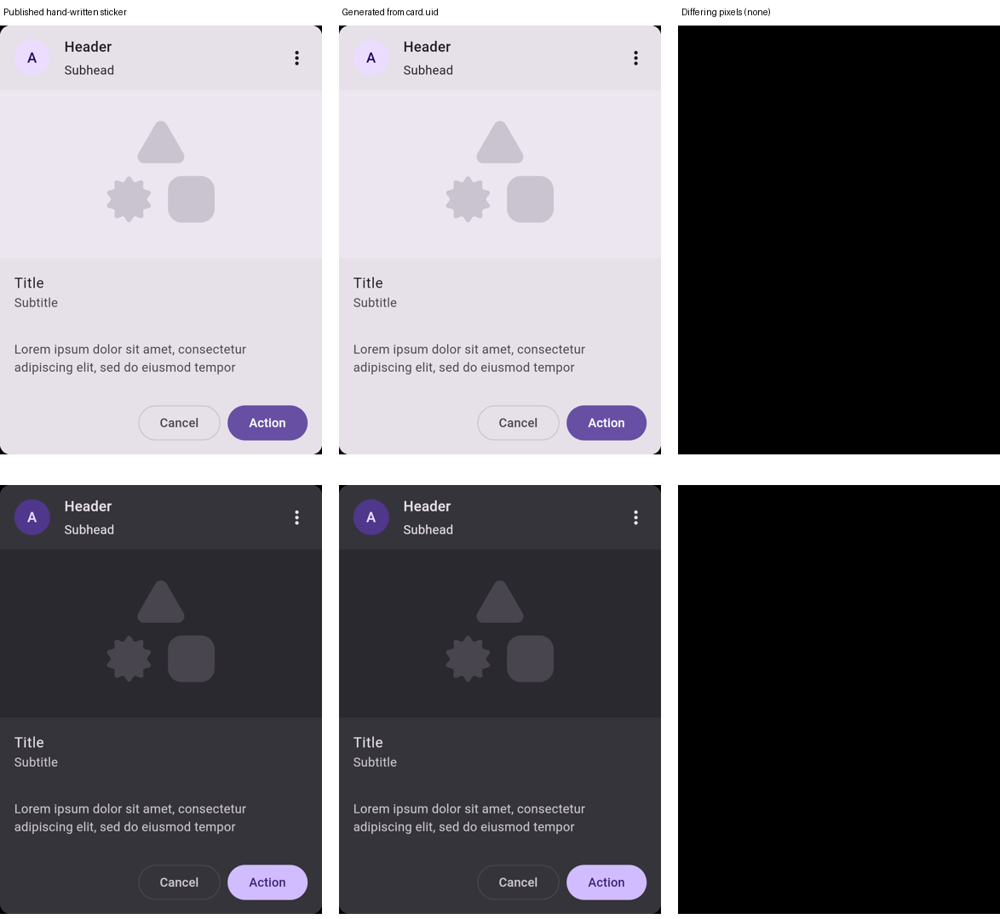
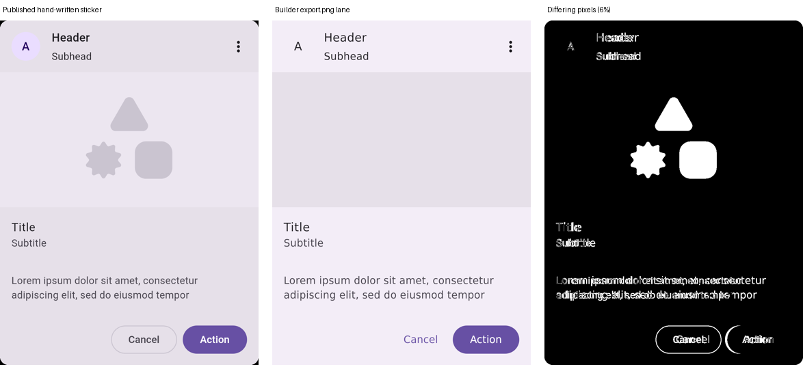

# Stickers defined as UI builder documents: investigation and prototype

**Status: 50 of 59 stickers (84%) cut over.** Their bodies in `:catalog` are now the components the
UI builder exports from their documents (checked in as `catalog/src/uid/kotlin`), and every one of
`:catalog`'s 4,170 captures is pixel-identical to before the cutover; the table and the steps are in
[`uid-stickers/CUTOVER.md`](../../uid-stickers/CUTOVER.md), the method in
[`uid-stickers/MIGRATING.md`](../../uid-stickers/MIGRATING.md).

The question was whether a
kit-matched sticker should be defined in UI builder syntax (a `.uid` document) instead of
hand-written Compose. There were four reasons to try:

1. **Reachability.** If the sticker *is* a builder document, the builder provably reaches every
   final result the catalog publishes.
2. **Manipulable data.** A variant or an override becomes an edit to a document rather than a knob
   threaded through Kotlin.
3. **Clean source.** The published source becomes the builder's own export, so
   `PlaygroundSourceCleaner` (1,740 lines in compose-preview-server) has nothing to strip.
4. **Forking.** "Open in UI Builder" from a preview opens the exact document behind it, instead of
   reconstructing one.

## Result in one paragraph

For the Card family this works today, to the pixel. One 22-node document,
[`uid-stickers/stickers/card.uid`](../../uid-stickers/stickers/card.uid), plus six cells of builder
operations, regenerates `Card/Filled`, `Card/Elevated` and `Card/Outlined` with their slot variants.
That is 12 renders across both modes, and **every one is byte-for-byte pixel-identical** to the
published hand-written sticker (`uid-stickers/compare-published.py`, max channel difference 0). The
generated Kotlin is the builder exporter's verbatim output, with no catalog scaffolding in it. It
does not generalise yet, though:

- **Vocabulary:** a static audit of all 59 stickers finds about a quarter fully reachable.
- **Lanes:** the builder's *canvas* lane does not draw what the *export* lane does.
- **Knobs and locales:** the overrides panel and the 17 locales lose today's knobs and string
  resources.

Those are the gaps to close before migrating anything.



## How the prototype is wired

```text
stickers/card.uid ───────┐                                 ┌─ internal fun KitCard(…)  ┐
stickers.json ───────────┤                                 ├─ KitCardSlot(…)           ├─ src/main/.../Cards.kt
:catalog components.json ┼─ generateUidStickers ───────────┼─ KitCardElevated(…)       │  @CatalogComponent +
  + ui-builder.json      │  (ScreenExportGate              ├─ … one per cell           ┘  KitCard(header =
builder/project records ─┘   .exportComponents)            └─ build/generated/uid/kotlin     catalogText(…), …)
```

- **The document is a component definition, placed once.** `KitCard`'s copy is `binding` values
  named for the published knob keys and its buttons carry action-free click events; the placement
  supplies the catalog's string resources, so the builder still shows real copy. Only the
  components are exported (`exportComponents`), as `internal` functions whose parameters are those
  bindings and events. Header row, avatar, media, text block and actions are all
  ordinary builder nodes: `m3/card`, `layout/row`, `m3/surface`, `m3/text` with style and
  `colorToken` values, `m3/icon-button`, and so on.
- **A cell is a list of builder operations**, in the `ui_builder_apply` vocabulary, applied before
  export:
  - `Slot` is `deleteNode content`.
  - `Elevated` is `setProperty card.style = elevated`.
  - Emphasis, which the catalog splits into separate stickers, is one property on one document.
    Nothing else changed between the three cards, and that is now visible in the data rather than
    in three copies of a composable.
- **The exporter is the one behind the builder's code pane.** It runs offline from Gradle, against
  the component record, with no server. The generated files keep the exporter's own package
  (`generated.uibuilder`) and names, untouched.
- **The shell is the only hand-written Kotlin.** Annotations, `Sticker { … }`, `@CaptureGutter`
  for the elevated shadow, and the live knobs: it calls
  `KitCard(header = catalogText("header", …), …, onActionClick = counted(…).onClick)`. That keeps the
  inventory annotation-first and the generated body free of catalog code.

Regenerate it, against the released exporter (the `uiBuilderExport` pin in
`gradle/libs.versions.toml`):

```sh
scripts/agent-gradle.sh -PuidStickers=true :uid-stickers:generateUidStickers  # rewrite catalog/src/uid/kotlin
scripts/agent-gradle.sh -PuidStickers=true :uid-stickers:verifyUidStickers    # fail if it is stale
```

## What the prototype established

### 1. The export lane is record-driven, so vocabulary is the catalog's to extend

Two things the builder's embedded record refused were fixed by **record entries**, with no builder
release:

- **`OutlinedButton`.** The builder's embedded `m3-catalog` fixture has no outlined button, and
  `m3/button.style` stops at `filled|filledTonal|text|fab`. But m3-catalog's *published* policy
  already declares `m3/outlined-button` (and `m3/suggestion-chip`). Now that the generator reads the
  published pair (prerequisite 2 below), the documents simply name those ids.
- **The kit's image placeholder.** `M3/.add-on/placeholder image` is a kit component, so the catalog
  publishes it as one: `m3catalog/image-placeholder`, a `PROJECT`-origin record entry over a
  builder-facing wrapper (`uid-stickers/.../BuilderComponents.kt`). The exporter emits
  `ImagePlaceholder(…)` and imports it from the catalog. The kit's "media" really is that one shared
  add-on, so it belongs as a component rather than a raster `asset/image`. A raster cannot follow
  light/dark.

**Limit:** typed values. A `Shape` parameter is refused (`` `shape` is Shape, which Text is not ``),
so the wrapper exposes `cornerRadiusDp: Float` instead. This is the same gap as the audit's #1
(shapes).

### 2. Two builder lanes, and only one of them reaches the sticker

The builder draws a design two ways:

- **The export lane** (Kotlin, real Compose and fonts, the catalog's own theme). Pixel-identical,
  above.
- **The canvas / `export.png` lane** the editor shows. 6% of pixels differ on the same document:
  - a fallback font instead of Roboto;
  - the avatar's `primaryContainer` fill is not painted;
  - a lighter card container.

  Button styles are also hand-dispatched in the editor (`CanvasScaffolds.kt` `BuilderButton`,
  `ComposeEmitter.kt` `buttonSymbol()`), so a record entry alone does not make the canvas draw an
  outlined button.



So "the builder reaches each final result" holds for **export**. For the **editor view** it waits on
the catalog-owned renderer: the typed adapter / `catalog-ui-builder-renderer` work in
[TYPED_M3_CATALOG.md](TYPED_M3_CATALOG.md), which draws with the catalog's real components. A fork
opened in today's editor would look subtly unlike the sticker it came from.

### 3. Clean source: achieved, and the reason is structural

The generated `KitCard.kt` is 72 lines of plain Compose, imports included, and its parameters are the
card's knobs and click callbacks:

- string literals and `MaterialTheme` tokens;
- no `Sticker`, `counted`, `catalogText`, `catalogChoice` or `catalogInteractive()`;
- no annotations.

Compare `Cards.kt`: 238 lines across `CardBody`, `CardHeader` and three stickers, each
branching on `catalogInteractive()`. There is nothing to clean because the scaffolding never enters
the body. It lives in the shell and in the cell operations. The publish step can ship the generated
file as the sticker's source verbatim.

Cost: the export's style is the generator's, not ktfmt's (4-space indent, long lines). The exporter
also adds a `Box(Modifier.fillMaxSize())` inside every `Card` and an empty-bodied `Box { }`. Both
are cosmetic, and both are upstream generator issues.

### 4. Fork to builder: the mechanism exists; the catalog has to match

The server already serves a digest-bound **Open in UI Builder** link for a preview carrying a `.uid`
reference (`ServeUidReference`, built for the adaptive pilot). A `.uid` sticker could publish its
document, and each cell's patched document, through the same reference manifest. That makes the
fork free and exact.

The prototype also shows the catch. The hosted builder **refuses** `card.uid`:
`UNKNOWN_COMPONENT: child cancel` / `child media`. It serves a smaller curated catalog than the one
the sticker was generated against. A fork is exact only when the generator, the published builder
catalog and the editor all read **one** vocabulary. That vocabulary has to be the catalog's
*declared* policy, not the discovery record. Discovery records what sticker bodies call, so it would
be circular once bodies are generated from it. The `catalog-typed-policy` trial is already that
declared source.

### 5. Overrides: more addressable, but today's panel loses them

- **More reach.** Every literal in the document is addressable as `nodeId.property`: 33 values on
  the card (8 texts), against 9 knobs today. A cell is just a saved set of those edits, and so is
  any live override.
- **But the live panel only offers `focus`.** It is built from `previewOverride*` calls, and the
  generated code holds literals, so a reader of the live preview loses the 8 text knobs.

Two ways to close it, neither prototyped:

- **(a)** Teach `ScreenGenerator` a *render lane* that reads chosen properties through a supplied
  lookup (`value("title.text", "Title")`). The published lane stays literal. This is an upstream
  compose-ai-tools change, and still nothing is stripped, because both lanes are generated.
- **(b)** Have the server apply the override as a `setProperty` and render the patched document
  through the native lane.

Either way, the panel needs a declared list of *exposed* properties. Otherwise all 33 appear,
including the avatar's `A`, which is pinned on purpose today.

### 6. Rules this would break today

- **String resources and 17 locales.** The builder has no string-resource value kind, so a `.uid`
  sticker renders English literals. That breaks `CatalogTranslationsTest`'s rule. It is a hard
  prerequisite: a `{"type": "stringResource", "key": "card_title"}` value the exporter lowers to
  `stringResource(Res.string.card_title)`.
- **Interactive vs baked.** `Cards.kt` composes the clickable `Card(onClick)` overload only in the
  live lane, so the baked node tree stays free of a clickable node. One document cannot be both. The
  prototype draws the plain overload, which matches the baked lane only.
- **Cross-module meta-annotations.** Discovery did not follow `:catalog`'s
  `@CatalogModesKitContainer` into this module, so the shell spells out its two `@Preview`s.

## Coverage across the whole sticker sheet (static audit)

A read of every `@CatalogComponent` against the builder vocabulary: the published `m3-catalog`
table, `ui-builder.policy.json`, the foundation builtins and the typed adapters.

| Class | Count |
| --- | --- |
| Reachable: every cell expressible | 15 |
| Partial, default cell expressible | 32 |
| Partial, default cell blocked | 11 |
| Gap: no builder component | 1 (`Shape/MaterialShapes`) |

The audit excluded interaction cells (hovered, focused, focus-ring, pressed) as unreachable. That was
wrong; see [Interaction cells come from the shell](#interaction-cells-come-from-the-shell). They are
`@OverrideVariant(interaction = …)` on the preview, which the render harness applies to whatever
the body draws. They cover 970 of the 1,384 exhaustive kit cells, and they travel with the shell.

**This audit is conservative where the prototype went further.** It classed the three Cards as
default-blocked. The export lane took `primaryContainer` as a colour token without complaint, and
the placeholder became a catalog record component. The 14-token limit it cites is the
typed-adapter canvas's, not the exporter's.

Vocabulary additions ranked by stickers unlocked:

1. **Shapes (~13):** `shape` on `m3/button` / `m3/icon-button`, per-corner radii, `MaterialShapes`
   in `clip`.
2. **Full colour-role tokens in the canvas lane (~11).**
3. **`contentPadding` on the button families (10):** this alone opens every XS–XL size cell.
4. **The image placeholder as a component (5):** done here, for Card.
5. **`colors` / `isError` / `contentColor` on selection controls and icon buttons (4).**
6. **List-item slots:** `leading`, `overline`, and `containerColor`.
7. **App bars and rails:** `containerColor`, `navigationIcon`/`actions` slots, `elevationDp` on the
   FAB ids.
8. **Slider, tab, wavy-progress and single-sticker properties.**

Sticker logic a document cannot hold today:

- scripted gestures and focus traversal (`@InteractionPreview`, `@FocusedPreview(traverse = …)`), until
  one is tried on a generated body. Plain `@InteractionStates` cells already work; see below.
- the expressive vs standard overload split (`Buttons.kt`, `IconButtons.kt`);
- `kitHeight`'s font-scale-conditional modifier;
- `BoxWithConstraints` scaling;
- composition-local providers with no node (`InlineDialogHost`, `ProvideTextStyle`);
- capture framing (`@CaptureGutter`, which here moves to the shell).

### Interaction cells come from the shell

`Chip/Suggestion` was added to test this. It is one 2-node document (`stickers/suggestion-chip.uid`)
plus a `Disabled` cell that sets `chip.enabled = false`. The shell carries the
`@InteractionStates` cells, spelled out as `@OverrideVariant(interaction = Hovered | Focused |
Pressed)` and `focus-ring`. The document holds no interaction state.

Results, from `compare-published.py`:

- **All 12 renders are pixel-identical to the published sticker:** default, disabled, hovered,
  focused, focus-ring and pressed, in light and dark.
- **Every interaction cell differs from the resting chip** (5,000 to 13,000 px), so the matches are
  real state layers, not a no-op render that happens to match.

The harness drives the state, and the `focus=ring` knob is read by `Sticker`'s frame. So a
generated body needs no interaction support of its own.

## How close is a switch, and is it all or nothing?

**It is not all or nothing.** The unit of migration is one sticker:

- the shell keeps `@CatalogComponent` and the inventory annotation-first;
- discovery, the design map and delivery cannot tell a generated body from a written one;
- each migrated sticker is gated by pixel identity against the published capture.

A group file can hold both kinds.

**But nothing can switch in the published catalog yet.** Three prerequisites are global:

1. **String resources.** Documents used to hold only literal text, which broke
   `CatalogTranslationsTest`. **Addressed by yschimke/compose-ui-builder#729, pending release.** A
   `{"type": "resource", "resourceKey": …}` value exports as `stringResource(Res.string.…)` through
   the accessor the catalog declares. The prototype's Card and chip copy now uses it:
   - all 24 English cells are still pixel-identical;
   - a German render of the generated Card matches the hand-written `FilledCard()` in German.
2. **One declared vocabulary** shared by the generator, the published builder catalog and the editor.
   **Addressed for the generator.** `generateUidStickers` no longer reads a hand-edited record: it
   joins `:catalog`'s own discovered `components.json` through its `ui-builder.json` policy, the pair
   the delivery branch publishes, so a document can name only ids the builder serves for
   `m3-catalog`. Two small files remain beside it: the builder's own `layout/` builtins
   (`builder-foundation-record.json`, which no artifact ships yet) and the module's one project
   component (`project-components.json`). **Still open: the editor.** Its code pane exports against
   an embedded fixture (`m3-catalog-components-v1.json`) rather than the served pair, which is why it
   lacks `OutlinedButton`; it should export against the records the server already joins
   (`PublishedUiBuilderCatalog.Composed.records`).
3. **Live overrides.** **Addressed, pending release.** The card is a `KitCard` component whose copy
   is `binding` values named for the published knobs (`header`, `subhead`, `title`, `subtitle`,
   `supportingText`, `action`, `dismissAction`). The shell passes `catalogText(…)` for each, reading
   them in the hand-written order, so the generated sticker's Overrides panel declares exactly the
   published keys. The `layout=slot` axis is a live `catalogChoice` in the shell choosing between the
   media and slot cells, proven by `@OverrideVariant(name = "slot")` renders that match the published
   slot captures. The chip's `label` and `enabled` are bindings too, so `disabled` is the published
   `status=disabled` override rather than a second document.
4. **Live click handlers.** **Addressed, pending release.** An event with no actions on a node inside
   a component is the component's API: it exports as a named callback parameter (`onCancelClick`,
   `onActionClick`, `onMoreClick`, `onChipClick`), and the shell wires each to `counted(…).onClick`.
   Nothing is filled with `{}`, `counted` stays out of the published source, and a screen that places
   the component with no handler is still refused. **Gap:** `Card`'s clickable overload is not in the
   record, so the hand-written sticker's interactive-mode card click (`counted(title)`) has no
   counterpart yet.

   Upstream: yschimke/compose-ai-tools#5883 (`ScreenGenerator.Output.COMPONENTS`: only the
   components, as `internal` functions) and a compose-ui-builder follow-up to #729
   (`ScreenExportGate.exportComponents`, readable intent callbacks, `resource` placement arguments).

**Measured, not estimated.** The estimate here was ~30% now and ~75–80% after vocabulary work.
The migration then ran sticker by sticker, each held to every published capture
(`compare-local.py`):

| Stage | Stickers | Share |
| --- | --- | --- |
| Wave 1: the vocabulary as it stood (shape tokens and padding values already worked) | 32 | 54% |
| Wave 2: colour bundles, outlines, enum and state values, toggle intents, empty optional slots | +12 | 75% |
| Wave 3: toggle-button shapes, top app bar colours | +6 | **85%** |
| Still hand-written | 9 | 15% |

The nine that remain need vocabulary, not logic: state holders the document cannot yet build
(search bar, range slider, date picker, carousel), members of an object or a scope as call sites
(split button, segmented buttons, menu group shapes), the slider's thumb and track, and
`MaterialShapes`. Each refusal is recorded in `uid-stickers/blocked/` and `CUTOVER.md`.

Things the estimate expected to stay hand-written turned out not to:

- **Dialog and popup hosts** stay in the shell around a generated body.
- **The expressive vs standard overload split and `kitHeight`'s font-scale branch** are invisible
  in every published capture (light and dark at font scale 1, standard theme). The shells drop
  them, and say so; restoring them is an exporter feature (expressive overload records, a min-height
  modifier), not a reason to keep the sticker hand-written.
- **Matrix cells** (button sizes × shapes, text-field configurations) are generated cells, with
  `uid-stickers/tools/` scripts writing the larger matrices.

Known behaviour differences that no capture shows, all recorded in their shells:

- Card's interactive-mode `onClick` overload has no record.
- Tab and icon-switch selection is a cell per value, so a live tap swaps generated functions and
  the indicator or thumb jumps rather than animating. An `Int` binding for the tab row and a
  binding for the thumb icon would fix it.
- Text fields take an inert `onValueChange`, because a typed value is not an intent.

## Recommendation

**Worth doing, as a per-group migration behind the existing gates, not a rewrite.** The Card result
shows the format can carry a kit-matched sticker exactly, and the payoff is concrete:

- the source cleaner retires for migrated groups;
- variants become data;
- the fork link becomes exact.

Order:

1. **Prerequisites upstream:**
   - string-resource values in the document and exporter;
   - typed `Shape` values;
   - a generator render lane (or server-side patching) for live overrides;
   - an exposed-properties declaration.
2. **One vocabulary:**
   - generate from the catalog's declared policy (`catalog-typed-policy`), not a copied record;
   - publish that same catalog to the builder;
   - publish each sticker's document as its `ui-builder` reference so the fork link is exact.
3. **Migrate the reachable groups first**, each gated by the same pixel-identity check as
   `compare-local.py`, run in CI against the hand-written renders:
   - Cards (done here);
   - Badges, Dividers, Dialog/Basic, Snackbar, TextFields, Chips/Assist and Chips/Suggestion,
     Typography.
4. **Leave shape-heavy and logic-heavy groups hand-written** until the format grows shapes, and
   for the ~20% that is logic, indefinitely. Interaction-heavy groups are no longer a reason to
   wait: their cells live on the shell. A mixed sheet is fine, since the shell keeps the inventory
   annotation-first either way.

## Files

- `uid-stickers/stickers/card.uid`, `uid-stickers/stickers/suggestion-chip.uid`: the documents.
- `uid-stickers/stickers.json`: their cells.
- `uid-stickers/builder-foundation-record.json`: the builder's `layout/` builtins.
- `uid-stickers/project-components.json`: `m3catalog/image-placeholder`, the module's own component.
  Everything else resolves against `:catalog`'s published pair.
- `uid-stickers/src/generator`: the export step.
- `uid-stickers/src/main`: the shell and the builder-facing placeholder.
- `uid-stickers/compare-local.py`: the cutover check against every hand-written capture (it
  replaced `compare-published.py`, which checked a hand-kept list of delivery-branch images).
